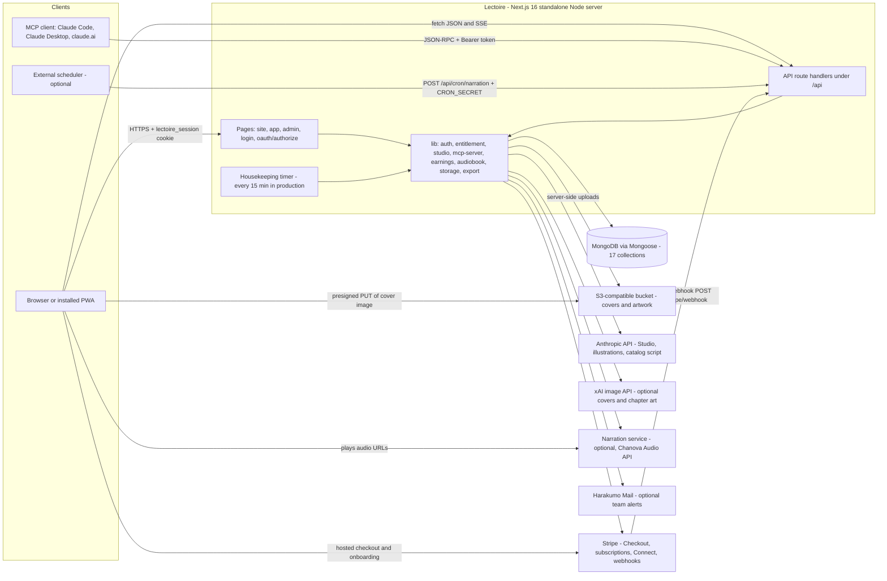
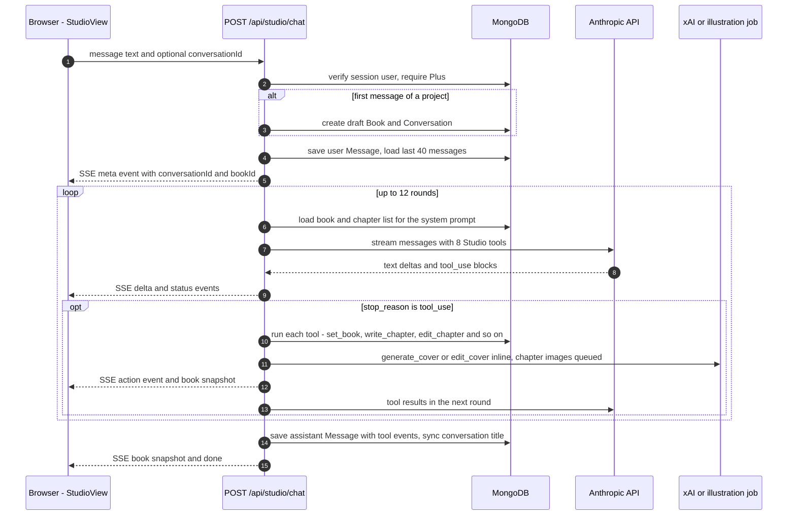

# Lectoire — Architecture

Lectoire is a book platform in the spirit of Apple Books and Kindle: a store, a
reader, a personal library, an AI writing Studio, an MCP connector for Claude,
a Plus subscription, book sales with creator payouts, printed-copy orders and
optional narration. Everything runs as **one Next.js 16 application** (App
Router, React 19) on a long-running Node server, backed by **one MongoDB
database**. Outside services are called over HTTPS from the server; the browser
only ever talks to Lectoire itself, to Stripe's hosted pages, to the media
bucket (presigned uploads) and to the audio URLs the narration service returns.

This file describes the parts and how they talk. The data model, flows, limits
and security live in [SYSTEM-DESIGN.md](SYSTEM-DESIGN.md); the reasons behind
the choices are in [DECISIONS.md](DECISIONS.md). The payout design that predates
the code is [creator-payouts.md](creator-payouts.md).

## The parts at a glance

| Part | Where | What it does |
| --- | --- | --- |
| Pages | `app/` | Server components that query MongoDB directly and render. Route groups: `(site)` public marketing, `(app)` signed-in product, `(admin)` company admin. |
| API routes | `app/api/**/route.ts` (42 files) | JSON endpoints for client components, the Studio SSE stream, the MCP server, OAuth, Stripe webhook and the housekeeping hook. |
| Domain code | `lib/` | Models, auth, the reading gate, Studio tools, MCP tools, money, narration, media, exports. Pages and routes both call it. |
| Database | MongoDB, schemas in `lib/models.ts` | All text and state: users, books, chapters, shelves, chats, orders, ledger, OAuth grants, narration records, jobs. |
| Media | Any S3-compatible bucket (`lib/storage.ts`) | Uploaded covers, generated covers and chapter artwork. Served from `STORAGE_PUBLIC_URL`. |
| Background work | `instrumentation.ts` + `lib/housekeeping.ts` | In-process timer that resumes stalled narrations, illustrations and payouts. |
| PWA shell | `app/manifest.ts`, `public/sw.js`, `components/InstallButton.tsx` | Makes the site installable. The service worker caches nothing. |
| Catalog script | `scripts/generate-catalog.mjs` | Offline script that writes the "Lectoire Originals" store books with the Anthropic API straight into `books` and `chapters`. |

## Main request: one Studio turn

The Studio is the busiest path: a signed-in Plus member sends a message, the
server runs an agent loop against the Anthropic API, and the model's tools write
chapters into MongoDB while the browser watches a live preview.

A second money path, buying a book, is laid out step by step in
[SYSTEM-DESIGN.md](SYSTEM-DESIGN.md#buying-a-book).

## Pages

All `(app)` pages sit behind `app/(app)/layout.tsx`, which redirects to `/login`
when there is no valid session for an existing user. All `(admin)` pages sit
behind `app/(admin)/admin/layout.tsx`, which redirects non-admins to `/home`.
There is no `middleware`/`proxy` file; gating is done in layouts and handlers.

| Group | Routes |
| --- | --- |
| Public site `(site)` | `/` (landing), `/products`, `/install`, `/contact`, `/privacy`, `/terms` |
| Auth | `/login`, `/register`, `/forgot-password` (explains reset is manual; no email flow) |
| OAuth | `/oauth/authorize` (consent screen for claude.ai connectors) |
| Reader app `(app)` | `/home`, `/store`, `/store/[id]`, `/search`, `/library`, `/read/[id]`, `/studio`, `/studio/new`, `/studio/[id]`, `/studio/book/[bookId]`, `/edit/[id]`, `/plus`, `/earnings`, `/order/[id]`, `/orders`, `/connections`, `/invite`, `/profile` |
| Admin `(admin)` | `/admin`, `/admin/users`, `/admin/books`, `/admin/creators`, `/admin/revenue`, `/admin/subscriptions`, `/admin/orders`, `/admin/messages` |

`next.config.ts` adds a permanent redirect `/download` → `/install` and rewrites
`/.well-known/oauth-authorization-server` and
`/.well-known/oauth-protected-resource` to the OAuth metadata routes.

## API routes

Auth column: **cookie** = `lectoire_session` JWT (`lib/auth.ts`), **Plus** =
cookie plus an active subscription (or admin), **owner** = cookie and the book's
`ownerId`, **admin** = cookie and `role: "admin"`, **bearer** = MCP token or
OAuth access token, **public** = no sign-in.

| Route | Methods | Auth | Purpose |
| --- | --- | --- | --- |
| `/api/auth/register` | POST | public | Create account, maybe grant a founding-member month of Plus, set session |
| `/api/auth/login` | POST | public | Username or email + password, set session |
| `/api/auth/logout` | POST | cookie | Clear the cookie |
| `/api/profile` | PATCH | cookie | Name and saved delivery address |
| `/api/founding` | GET | public | Founding spots claimed and left |
| `/api/books/[id]` | PATCH, DELETE | owner | Edit metadata or cover URL; delete book with chapters, shelves and chats |
| `/api/books/[id]/chapters` | POST | owner | Append a chapter (runs the Studio `write_chapter` executor) |
| `/api/books/[id]/chapters/[index]` | PATCH, DELETE | owner | Edit or delete a chapter (Studio executors) |
| `/api/books/[id]/publish` | POST | owner | Publish or unpublish; publishing starts background narration |
| `/api/books/[id]/price` | POST | owner | Set digital price and paperback list price |
| `/api/books/[id]/buy` | POST | cookie | Create a Stripe Checkout session for one priced book |
| `/api/books/[id]/download` | GET | owner or admin | ZIP of EPUB, PDF, DOCX, HTML, Markdown, TXT and cover |
| `/api/books/[id]/narrate` | GET, POST | owner | Narration coverage for the book; narrate the whole book |
| `/api/books/[id]/audio/[index]` | GET, POST | cookie + reading gate | Read or start narration for one chapter |
| `/api/library` | POST | cookie | Toggle In Library, Want to Read, Finished |
| `/api/progress` | POST | cookie | Save reading position and chapters read |
| `/api/highlights`, `/api/highlights/[id]` | POST, PATCH, DELETE | cookie | Create, recolour, delete highlights |
| `/api/upload` | POST | cookie | Presigned PUT URL for a cover image |
| `/api/studio/chat` | POST | Plus | The Studio agent loop, streamed as Server-Sent Events |
| `/api/studio/extract` | POST | Plus | Pull text out of an uploaded PDF, DOCX, TXT or Markdown file |
| `/api/plus` | GET, POST, DELETE, PATCH | cookie | Subscription state; start checkout; cancel at period end; resume |
| `/api/orders` | GET, POST | cookie | List own print orders; place one (creates Checkout session) |
| `/api/orders/[id]` | PATCH, DELETE | admin; owner or admin | Admin status and tracking note; remove an unpaid order |
| `/api/orders/[id]/pay` | POST | cookie | Resume payment for an unpaid order |
| `/api/earnings` | GET, POST | cookie | Author earnings summary; start Stripe Connect onboarding |
| `/api/earnings/withdraw` | POST | cookie | Pay out the cleared balance |
| `/api/earnings/dashboard` | POST | cookie | One-time login link to the author's Stripe Express dashboard |
| `/api/admin/users/[id]` | PATCH | admin | Promote or demote a user |
| `/api/admin/messages/[id]` | PATCH, DELETE | admin | Contact message status; delete |
| `/api/admin/payouts` | GET, PATCH, POST | admin | Payable and frozen authors; freeze or release; run payouts |
| `/api/contact` | POST | public | Contact form, stored and copied to the team inbox |
| `/api/mcp-token` | POST, DELETE | cookie | Issue, rotate or revoke the personal `emb_` token |
| `/api/mcp` | POST (GET, DELETE answer 405) | bearer | Stateless MCP server, 12 tools |
| `/api/oauth/register` | POST | public | Dynamic client registration |
| `/api/oauth/approve` | POST | cookie | Consent decision; mints an authorization code |
| `/api/oauth/token` | POST | public + PKCE | Code and refresh-token exchange |
| `/api/oauth/grants/[id]` | DELETE | cookie | Disconnect a connected app |
| `/api/oauth/metadata/as`, `/pr` | GET | public | RFC 8414 and RFC 9728 discovery documents |
| `/api/stripe/webhook` | POST | Stripe signature | Plus state, book sales, print orders, refunds, disputes, Connect onboarding |
| `/api/cron/narration` | POST | `CRON_SECRET` bearer | Run one housekeeping sweep |

## Domain modules (`lib/`)

| Module | Role |
| --- | --- |
| `models.ts` | Every Mongoose schema and model, plus money constants (`AUTHOR_SHARE`, `MIN_PRICE_CENTS`, `HOLD_DAYS`, …) and `hasPlus`, `splitSale`, `isForSale` |
| `db.ts` | One cached Mongoose connection per process; reconnects when the cached socket is dead |
| `auth.ts` | bcrypt hashing, HS256 JWT session cookie, `getSession`, `getVerifiedUser`, `getAdminUser` |
| `entitlement.ts` | The single reading gate: owner, free, purchased, Plus, or locked |
| `studio.ts`, `studio-commands.ts` | Studio tool definitions, system prompt, tool executors; composer slash commands |
| `anthropic.ts` | Anthropic client, `BOOK_MODEL` and `ILLUSTRATION_MODEL` |
| `mcp-server.ts`, `oauth.ts` | MCP tool list and executor; bearer resolution, PKCE, CORS helpers |
| `imagine.ts`, `illustration.ts`, `covers.ts` | xAI covers and artwork; queued chapter illustrations with an SVG fallback; generated typeset covers |
| `audiobook.ts` | Narration client for the external audio service |
| `stripe.ts`, `subscription.ts`, `earnings.ts`, `pricing.ts`, `plan.ts` | Stripe client, Plus state mapping, the sales ledger and payouts, print pricing, the Plus plan |
| `storage.ts` | S3-compatible client, presigned uploads, server uploads, bucket URL checks |
| `export.ts` | EPUB, PDF (pdfkit), DOCX (docx), HTML, Markdown, TXT and ZIP building |
| `analytics.ts` | Admin revenue, subscriber, creator and book-sales figures, derived from the collections |
| `email.ts`, `harakumo.ts` | Fail-soft team alerts through Harakumo Mail |
| `housekeeping.ts` | The sweep and its in-process timer |
| `site.ts`, `genres.ts`, `order-statuses.ts`, `address.ts` | Public origin, product copy, invite text, constants, address parsing |

## Sign-in

- **Website:** username (or email) and password. Passwords are hashed with
  bcrypt (cost 12). A successful sign-in sets `lectoire_session`, an HS256 JWT
  signed with `AUTH_SECRET`, `httpOnly`, `SameSite=Lax`, `Secure` in production,
  valid 30 days. Pages call `getVerifiedUser()`, which also checks the user
  still exists.
- **MCP connector, personal token:** `/connections` issues an `emb_…` token
  stored on the user (`users.mcpToken`); clients send it as
  `Authorization: Bearer`.
- **MCP connector, OAuth:** claude.ai discovers `/.well-known/*`, registers
  itself at `/api/oauth/register`, sends the user to `/oauth/authorize` (which
  requires the website session), receives a single-use code from
  `/api/oauth/approve`, and exchanges it with a PKCE S256 verifier at
  `/api/oauth/token`. The resulting `embat_` access token is resolved on every
  MCP call by `resolveBearerUserId()`.

## Payments

All money goes through Stripe (`STRIPE_SECRET_KEY`, `STRIPE_WEBHOOK_SECRET`).
Without the keys, every payment route answers 503 "not configured" and the rest
of the app works.

| Flow | Stripe feature | Recorded in |
| --- | --- | --- |
| Lectoire Plus, $5.99 a month | Checkout `mode: subscription`, customer per user | `users.subscription` |
| Buying a priced book | Checkout `mode: payment`, metadata `kind: book_purchase` | `purchases` (ledger) and a `libraryentries` shelf row |
| Printed paperback | Checkout `mode: payment` with printing, delivery and tax lines | `orders`, plus a `purchases` row when the author set a list price above cost |
| Author payouts | Connect Express accounts, Transfers with idempotency keys | `authoraccounts`, `payoutrecords` |

The webhook handles `checkout.session.completed`, `charge.refunded`,
`charge.dispute.created`, `account.updated`,
`customer.subscription.updated` and `customer.subscription.deleted`.

## Storage

Media goes to an S3-compatible bucket through a standard S3 client library
(`STORAGE_BUCKET`, `STORAGE_ACCESS_KEY_ID`, `STORAGE_SECRET_ACCESS_KEY`,
`STORAGE_ENDPOINT`, `STORAGE_PUBLIC_URL`, optional `STORAGE_REGION`).

| Object key | Written by |
| --- | --- |
| `lectoire/covers/{userId}/{uuid}.{ext}` | The browser, via a presigned PUT from `/api/upload` |
| `covers/{sha256}.webp` | `generateCover` / `editCover` (xAI) |
| `illustrations/{sha256}.webp` | `generateChapterImage` (xAI) |
| `illustrations/{bookId}/{sha256}.svg` and `.png` | The SVG fallback illustrator when no xAI key is set |

Chapter text, chats and everything else stay in MongoDB. Narration audio is not
stored by Lectoire: the narration service returns URLs and only those are saved.

## Outside services

| Service | Needed? | Environment | Used for |
| --- | --- | --- | --- |
| MongoDB | Required | `MONGODB_URI` | All data |
| Session secret | Required | `AUTH_SECRET` | JWT signing |
| Anthropic API | Required for the Studio | `ANTHROPIC_API_KEY`, `BOOK_MODEL`, `ILLUSTRATION_MODEL` | Studio agent (default `claude-haiku-4-5-20251001`), SVG illustrations (default `claude-opus-5`), catalog script |
| S3-compatible bucket | Optional locally, needed in production | `STORAGE_*` | Covers and artwork |
| xAI image API | Optional | `XAI_API_KEY`, `XAI_IMAGE_MODEL` | Generated and edited covers, chapter art |
| Narration service | Optional | `CHANOVA_AUDIO_URL`, `CHANOVA_AUDIO_KEY` | Chapter audio (`POST /v1/speech`, `GET /v1/jobs/:id`) |
| Stripe | Optional | `STRIPE_SECRET_KEY`, `STRIPE_WEBHOOK_SECRET` | Plus, sales, print orders, payouts |
| Harakumo Mail | Optional | `HARAKUMO_API_KEY`, `HARAKUMO_BASE_URL`, `ADMIN_EMAIL`, `CONTACT_EMAIL` | Team alerts: contact messages, paid print orders, disputes |
| Scheduler | Optional | `CRON_SECRET` | Drive housekeeping from outside |
| Public origin | Set before build | `NEXT_PUBLIC_ORIGIN` | Invite links, MCP URL, some Stripe return URLs |

The reader also has a browser-only "listen" mode using the Web Speech API
(`speechSynthesis`), and the Studio composer offers voice dictation through the
same browser API. Neither touches the server.

## Background work

There is no job queue. Long work is started with a detached promise in the same
Node process (`void narrateBook(...)`, `void runIllustrationJob(...)`,
`notifyAdmin(...)`), and a sweep picks up what a restart interrupts:

- `instrumentation.ts` calls `startHousekeeping()` once per Node process. In
  production (and only with `MONGODB_URI` set) it runs `runHousekeeping()` every
  `HOUSEKEEPING_INTERVAL_MINUTES` (default 15, `0` turns it off), never
  overlapping itself and never keeping the process alive.
- The same sweep can be triggered by `POST /api/cron/narration` with
  `Authorization: Bearer $CRON_SECRET`.
- One sweep runs four steps in parallel: resume stalled narrations, adopt audio
  the service already holds, finish pending payouts, resume pending
  illustrations.

## Deployment shape

`next.config.ts` sets `output: "standalone"` and keeps `mongoose` and `pdfkit`
out of the bundle. The `Dockerfile` builds on `node:22-slim`, passes
`NEXT_PUBLIC_ORIGIN` as a build argument, copies `.next/standalone`,
`.next/static` and `public/`, and runs `node server.js` on port 3000. Studio
turns stream for up to 300 seconds, so whatever sits in front of the server must
not cut long responses. The README also describes running it as a server app on
Harakumo.
