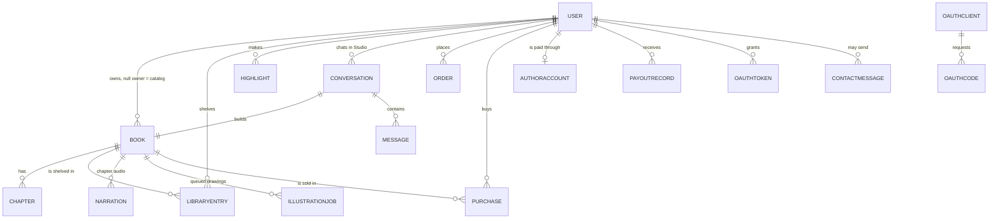
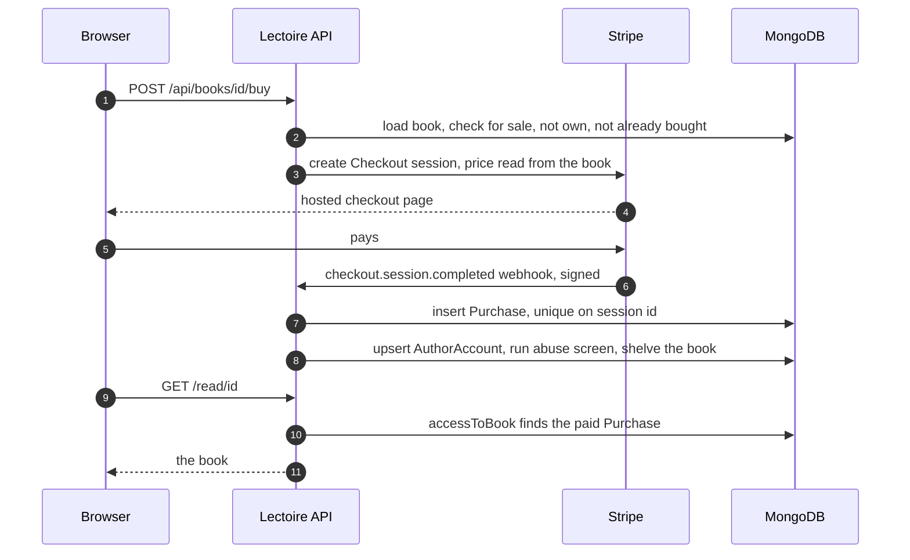

# Lectoire — System design

How Lectoire stores its data, how the main flows run, who may do what, the
limits the code enforces, how it fails, how it is secured and how it scales.
Every statement here describes the code in this repository. Where something is
not built, it says so. Parts and wiring are in
[ARCHITECTURE.md](ARCHITECTURE.md); reasons are in [DECISIONS.md](DECISIONS.md).

## Data model

One MongoDB database, 17 collections, all defined in `lib/models.ts` with
Mongoose. Every schema has `timestamps: true`, so every document also carries
`createdAt` and `updatedAt` (Date). Money is always integer **cents**, USD.
Collection names are Mongoose's lowercase plurals of the model names.

### `users` — model `User`

| Field | Type | Notes |
| --- | --- | --- |
| `name` | String | required, trimmed, max 80 |
| `username` | String | required, unique, lowercase, `^[a-z0-9_.]{3,20}$` |
| `email` | String | default `""`, lowercase, max 200; unique when non-empty (partial index). Required by the register route, optional in the schema for older accounts |
| `passwordHash` | String | required, bcrypt |
| `role` | `"user"` \| `"admin"` | default `"user"` |
| `mcpToken` | String | personal MCP token `emb_…`, `""` when none; unique when non-empty |
| `savedAddress` | Address \| null | last delivery address (fields below) |
| `foundingMember` | Boolean | one of the first 10 sign-ups |
| `subscription.status` | `"none"` \| `"active"` \| `"past_due"` \| `"canceled"` | Lectoire Plus state mirrored from Stripe |
| `subscription.stripeCustomerId` | String | |
| `subscription.stripeSubscriptionId` | String | empty for a free founding grant |
| `subscription.currentPeriodEnd` | Date \| null | paid-through date |
| `subscription.cancelAtPeriodEnd` | Boolean | |

Address (embedded in `users.savedAddress` and `orders.address`): `name`,
`phone`, `line1`, `line2`, `city`, `state`, `postalCode`, `country`, all
String. In orders, `name`, `line1`, `city`, `postalCode` and `country` are
required.

### `books` — model `Book`

| Field | Type | Notes |
| --- | --- | --- |
| `ownerId` | ObjectId → User \| null | `null` = built-in catalog ("Lectoire Originals"); indexed |
| `title` | String | required, max 200 |
| `subtitle` | String | max 300 |
| `authorName` | String | byline, max 120 |
| `description` | String | back-cover blurb, max 5000; required to publish |
| `genre` | String | default `"Fiction"`; routes accept only the 14 values in `lib/genres.ts` |
| `tags` | [String] | the Studio keeps up to 8 |
| `status` | `"draft"` \| `"published"` | |
| `coverUrl` | String | uploaded or generated art in the bucket; `""` = generated typeset cover |
| `coverStyle.palette` | Number | index into 12 palettes (`lib/covers.ts`) |
| `coverStyle.layout` | Number | index into 4 layouts |
| `flags.bestseller`, `flags.free`, `flags.featured` | Boolean | set by the catalog script; no admin UI sets them |
| `sale.enabled` | Boolean | author switched selling on |
| `sale.priceCents` | Number | min 0; for sale only when enabled and ≥ 299 |
| `sale.printPriceCents` | Number | paperback list price; 0 = print at cost |
| `sale.currency` | String | `"usd"` |
| `chapterCount`, `wordCount` | Number | recomputed after every chapter change |
| `publishedAt` | Date \| null | |

Indexes: `{status, publishedAt: -1}`, `{status, genre}`, `ownerId`.

### `chapters` — model `Chapter`

| Field | Type | Notes |
| --- | --- | --- |
| `bookId` | ObjectId → Book | required |
| `index` | Number | 1-based position, required |
| `title` | String | required, max 200 |
| `content` | String | Markdown, may contain image links to the bucket |
| `wordCount` | Number | |

Index: `{bookId, index}` unique. Deleting a chapter shifts later ones up.

### `libraryentries` — model `LibraryEntry`

| Field | Type | Notes |
| --- | --- | --- |
| `userId`, `bookId` | ObjectId | required |
| `inLibrary`, `wantToRead`, `finished` | Boolean | shelf flags |
| `progress.chapterIndex` | Number | |
| `progress.offset` | Number | 0..1 scroll position in the chapter |
| `progress.percent` | Number | 0..1, share of chapters actually read |
| `progress.chaptersRead` | [Number] | chapters finished |
| `lastReadAt` | Date \| null | drives "Continue reading" |

Indexes: `{userId, bookId}` unique, `{userId, lastReadAt: -1}`.

### `highlights` — model `Highlight`

| Field | Type | Notes |
| --- | --- | --- |
| `userId`, `bookId` | ObjectId | required |
| `chapterIndex` | Number | required |
| `text` | String | required, max 1200 |
| `start` | Number | character offset in the chapter's plain text, min 0 |
| `color` | `"amber"` \| `"green"` \| `"rose"` \| `"blue"` | default amber |

Index: `{userId, bookId, chapterIndex}`.

### `conversations` and `messages` — models `Conversation`, `Message`

| Collection | Field | Type | Notes |
| --- | --- | --- | --- |
| conversations | `userId` | ObjectId | indexed |
| conversations | `bookId` | ObjectId → Book | the draft this project builds |
| conversations | `title` | String | max 160, synced to the book title |
| conversations | `lastMessageAt` | Date | |
| messages | `conversationId` | ObjectId | required |
| messages | `role` | `"user"` \| `"assistant"` | |
| messages | `content` | String | text only; tool exchanges are not stored |
| messages | `events` | [{`tool`: String, `label`: String}] | the activity feed of a turn |

Indexes: `{userId, lastMessageAt: -1}` on conversations,
`{conversationId, createdAt: 1}` on messages.

### `narrations` — model `Narration`

| Field | Type | Notes |
| --- | --- | --- |
| `bookId` | ObjectId | required |
| `chapterIndex` | Number | required |
| `textHash` | String | first 32 hex chars of sha256 of the spoken text |
| `voice` | String | one of 5 voices, default `af_heart` |
| `jobId` | String | job id at the narration service |
| `status` | `"preparing"` \| `"ready"` \| `"error"` | |
| `urls` | [String] | audio part URLs returned by the service |
| `parts`, `totalParts` | Number | |
| `durationSeconds` | Number | |
| `error` | String | |

Index: `{bookId, chapterIndex, textHash, voice}` unique. Editing a chapter
changes the hash, so stale audio is never matched.

### `illustrationjobs` — model `IllustrationJob`

| Field | Type | Notes |
| --- | --- | --- |
| `bookId` | ObjectId | indexed |
| `chapterIndex` | Number | |
| `subject` | String | the scene to draw |
| `alt` | String | default `"Illustration"` |
| `placement` | `"top"` \| `"bottom"` | |
| `status` | `"pending"` \| `"done"` \| `"error"` | indexed |
| `error` | String | |
| `attempts` | Number | gives up after 3 |

### `orders` — model `Order`

| Field | Type | Notes |
| --- | --- | --- |
| `userId`, `bookId` | ObjectId | required |
| `bookTitle`, `bookAuthor` | String | snapshots, so the order survives book edits |
| `quantity` | Number | 1 to 10 |
| `pages` | Number | estimated printed pages |
| `address` | Address | required |
| `amounts.printing`, `amounts.delivery`, `amounts.tax`, `amounts.total` | Number | cents |
| `status` | `pending_payment` \| `paid` \| `printing` \| `shipped` \| `delivered` \| `cancelled` | |
| `stripeSessionId` | String | |
| `note` | String | admin note to the customer, max 500 |

Indexes: `{userId, createdAt: -1}`, `{status, createdAt: -1}`, `stripeSessionId`.

### `purchases` — model `Purchase` (the sales ledger)

| Field | Type | Notes |
| --- | --- | --- |
| `bookId`, `buyerId` | ObjectId | required, indexed |
| `authorId` | ObjectId \| null | indexed |
| `grossCents`, `feeCents`, `netCents`, `authorCents`, `platformCents` | Number | the split of this sale |
| `currency` | String | `"usd"` |
| `stripeSessionId` | String | unique when non-empty; print rows use `{sessionId}_print` |
| `status` | `"paid"` \| `"refunded"` \| `"disputed"` | only `paid` grants access and counts as earnings |
| `refundedAt` | Date \| null | |

Indexes: `stripeSessionId` unique partial, `{buyerId, bookId}`,
`{authorId, createdAt: -1}`. Rows are never deleted; refunds and disputes
change `status`.

### `authoraccounts` — model `AuthorAccount`

| Field | Type | Notes |
| --- | --- | --- |
| `userId` | ObjectId | unique |
| `stripeAccountId` | String | Connect Express account, indexed |
| `onboarded` | Boolean | `charges_enabled && payouts_enabled`, from the `account.updated` webhook |
| `balanceCents`, `lifetimeCents`, `paidOutCents` | Number | written as 0 on insert and not maintained; author earnings are computed from `purchases` and `payoutrecords` instead (see Known gaps) |
| `frozen` | Boolean | payouts paused |
| `frozenReason` | String | shown to the author |

### `payoutrecords` — model `PayoutRecord`

| Field | Type | Notes |
| --- | --- | --- |
| `authorId` | ObjectId | indexed |
| `amountCents` | Number | |
| `stripeTransferId` | String | set when the transfer succeeds |
| `status` | `"pending"` \| `"paid"` \| `"failed"` | pending and paid both count as already sent |
| `error` | String | |

### OAuth — models `OAuthClient`, `OAuthCode`, `OAuthToken`

| Collection | Field | Type | Notes |
| --- | --- | --- | --- |
| oauthclients | `clientId` | String | unique, `embc_…` |
| oauthclients | `name` | String | max 120, default `"Claude"` |
| oauthclients | `redirectUris` | [String] | up to 10, `https://` or `http://localhost` |
| oauthcodes | `code` | String | unique, `embac_…` |
| oauthcodes | `clientId`, `redirectUri`, `codeChallenge`, `scope` | String | PKCE S256 challenge required |
| oauthcodes | `userId` | ObjectId | |
| oauthcodes | `expiresAt` | Date | TTL index removes expired codes |
| oauthcodes | `usedAt` | Date \| null | single use |
| oauthtokens | `token` | String | unique, `embat_…` access token |
| oauthtokens | `refreshToken` | String | unique, `embrt_…` |
| oauthtokens | `userId` | ObjectId | indexed |
| oauthtokens | `clientId`, `clientName`, `scope` | String | |
| oauthtokens | `lastUsedAt` | Date \| null | |

### `contactmessages` — model `ContactMessage`

| Field | Type | Notes |
| --- | --- | --- |
| `userId` | ObjectId \| null | set when the sender was signed in |
| `name`, `email`, `subject`, `message` | String | required; max 120, 200, 200, 5000 |
| `status` | `"new"` \| `"read"` \| `"replied"` | |

Index: `{status, createdAt: -1}`.

## Main flows

### Sign-up and sign-in

1. `/register` posts name, username, email and password to
   `/api/auth/register`.
2. The route validates them (username pattern, email shape, password ≥ 8),
   rejects a taken username or email (409), hashes the password with bcrypt.
3. If fewer than 10 users have `foundingMember: true`, the new user becomes a
   founding member with `subscription.status: "active"` and a
   `currentPeriodEnd` one month out, with no Stripe subscription behind it.
4. A 30-day JWT is set in the `lectoire_session` cookie.
5. `/api/auth/login` accepts a username or, if the value contains `@`, an email.
6. There is no email verification and no password-reset email:
   `/forgot-password` says so and points to the contact address or form.

### A Studio turn

The full sequence is in [ARCHITECTURE.md](ARCHITECTURE.md#main-request-one-studio-turn).
In short: Plus is required; the first message creates a draft `Book` and a
`Conversation`; the route stores the user message, replays up to 40 earlier
text messages, and runs up to 12 rounds of streamed Anthropic calls with 8
tools. Tool calls execute against MongoDB (`executeStudioTool` in
`lib/studio.ts`), each emits an `action` event and, if the book changed, a
`book` snapshot. The route emits `meta`, `delta`, `status`, `action`, `book`,
`error` and `done` (the README also lists `title`, which neither the route nor
`StudioView` uses). The assistant message and its tool events are saved in a
`finally` block, even if the browser left.

The hand editor (`/edit/[id]`), the chapter API routes and the MCP tools call
the same `executeStudioTool` executors, so every way of editing behaves the same.

### Publishing and narration

1. Owner publishes from the editor (`/api/books/[id]/publish`) or MCP
   (`publish_book`). Both require at least one chapter and a description.
2. Status becomes `published`, `publishedAt` is set, and `narrateBook()` starts
   in the background when the narration service is configured.
3. `narrateBook` submits chapters two at a time. For each, the spoken text is
   the chapter title plus the Markdown stripped to prose; its hash keys the
   `Narration` record; the service is asked with `POST /v1/speech`.
4. Readers poll `GET /api/books/[id]/audio/[index]`. A `preparing` record is
   refreshed from `GET /v1/jobs/:id`; with no record, the route asks the service
   with `cache_only: true` (renders nothing) and adopts audio it already has.
5. Any reader who passes the reading gate can start narration of a chapter with
   `POST` on the same route. The author can re-narrate the whole book from the
   editor.

### Reading and the reading gate

`accessToBook()` in `lib/entitlement.ts` decides, in this order:

1. Owner → allowed.
2. Not published → refused (`unpublished`).
3. `flags.free` → allowed.
4. For sale (`sale.enabled` and price ≥ $2.99) → allowed only with a `paid`
   `Purchase` row for this reader, otherwise `needs-purchase`.
5. Otherwise the book is in the Plus catalogue → allowed for Plus members and
   admins, otherwise `needs-plus`.

The gate is applied by `/read/[id]` (redirects to the store page or `/plus`),
`/store/[id]` and the audio route. The reader saves progress to
`/api/progress` (percent = chapters finished ÷ chapter count), highlights to
`/api/highlights`, and shelves through `/api/library`.

### Buying a book

1. The store page shows **Buy** when the gate says `needs-purchase`.
2. `/api/books/[id]/buy` refuses unpublished, unpriced, own and already-owned
   books, reads the price from the book, and creates a Checkout session with
   metadata `kind: book_purchase`, `bookId`, `buyerId`, `authorId`.
3. On `checkout.session.completed` with `payment_status: paid`,
   `recordBookSale()` splits the amount (fee estimate 2.9% + 30¢, author 70% of
   the net), inserts the `Purchase`, creates the author's `AuthorAccount` if
   missing, runs the abuse screen and puts the book on the buyer's shelf.
4. Access depends on the webhook: there is no return-page check for book
   purchases (there is one for Plus and for print orders).

### Lectoire Plus

1. `/api/plus` POST creates or reuses a Stripe customer and a Checkout session
   for $5.99 a month (`lib/plan.ts`).
2. The webhook (`checkout.session.completed`, then
   `customer.subscription.updated` / `deleted`) writes `users.subscription`.
   The `/plus` return page also reads the session and writes it, and every
   other `/plus` visit re-syncs from Stripe, so local development works without
   webhook forwarding.
3. Stripe `active`/`trialing` map to `active`; `past_due`/`unpaid` to
   `past_due`; anything else to `canceled`.
4. Cancel (`DELETE`) sets `cancel_at_period_end`; resume (`PATCH`) clears it.
5. `hasPlus()` is true for admins, for paid subscriptions Stripe calls active,
   and for free founding grants until `currentPeriodEnd`.

### Print orders

1. `/order/[id]` posts book, quantity (1–10) and address to `/api/orders`.
2. Older unpaid orders for the same book and user are expired at Stripe and
   deleted.
3. Pricing (`lib/pricing.ts`): pages = max(24, ⌈words ÷ 275⌉ + 8); cost per
   copy = $5.00 + $0.04 × pages; the author's paperback price replaces cost when
   it is at least cost + $3.00; delivery $4.99 per order; tax a flat 8% of
   printing + delivery.
4. The order is saved as `pending_payment` and the address remembered; a
   Checkout session with printing, delivery and tax lines is created. If Stripe
   fails, the order is deleted and the route answers 502.
5. On payment the webhook marks it `paid`, records the author's print royalty
   (70% of the margin above cost, after a 2.9% fee) as a `Purchase` with key
   `{sessionId}_print`, and emails the team. The `/orders` return page also
   marks it paid.
6. Fulfilment is manual: an admin downloads the book, prints and ships it, and
   moves the status through `printing`, `shipped`, `delivered` with a tracking
   note. There is no print-provider integration.
7. Unpaid orders older than 24 hours are deleted when the customer opens
   `/orders`.

### Author earnings and payouts

1. The author sets a price at `/api/books/[id]/price` ($2.99–$99.99, not on a
   book flagged free; paperback ≥ cost + $3.00 and ≤ $199.99). Pricing a book
   takes it out of Plus.
2. `earningsFor()` derives everything from the ledger: `paid` purchases older
   than 30 days are settled, newer ones pending; `paid` and `pending`
   `PayoutRecord`s are subtracted from settled to give `available`.
3. `POST /api/earnings` creates a Stripe Connect Express account (individual,
   transfers capability) and returns Stripe's onboarding link. The
   `account.updated` webhook sets `onboarded`.
4. `POST /api/earnings/withdraw` runs `payoutAuthor()`: requires onboarding,
   not frozen, available ≥ $25; writes a `pending` `PayoutRecord` first, then
   creates a Stripe Transfer with idempotency key `emberleaf_payout_{recordId}`,
   then marks it `paid` (with the transfer id) or `failed` (money returns to
   available).
5. Refund (`charge.refunded`): the matching `Purchase` becomes `refunded`.
   Dispute (`charge.dispute.created`): it becomes `disputed`, the author is
   frozen and the team is emailed. Both stop the row counting toward earnings
   and stop it granting access.
6. The abuse screen after each sale freezes the author when: a buyer account
   under an hour old buys and the author has 3+ sales in 24 hours; one buyer
   buys 5+ of the author's books in 24 hours; or an author account under 7 days
   old has 10+ sales in 24 hours. Admins release or freeze from
   `/admin/creators` (`PATCH /api/admin/payouts`).

### Connecting Claude (MCP)

1. Personal token: `/connections` → `POST /api/mcp-token` issues `emb_` + 48 hex
   characters; `DELETE` revokes it.
2. OAuth: discovery → dynamic registration → `/oauth/authorize` (requires the
   website session; checks client and exact redirect URI; S256 only) → consent
   → `/api/oauth/approve` mints a 10-minute single-use code →
   `/api/oauth/token` checks code, client, redirect URI and PKCE verifier and
   issues an access and refresh token. Refresh rotates the access token and
   keeps the refresh token.
3. Every `POST /api/mcp` resolves the bearer to a user (401 with a
   `WWW-Authenticate` pointer to the resource metadata if not), handles
   `initialize`, `ping`, `tools/list`, `tools/call` (single or batched
   JSON-RPC), and re-resolves the token on every tool call.
4. The 12 tools: `list_my_books`, `create_book` (Plus only), `get_book`,
   `read_chapter`, `write_chapter`, `edit_chapter`, `delete_chapter`,
   `update_book`, `publish_book`, `unpublish_book`, `browse_store`,
   `delete_book` (requires `confirm: true`).

### Covers and illustrations

- Every book has a generated typeset cover from `coverStyle`; the Studio's
  `set_book` can restyle it.
- With `XAI_API_KEY`, `generate_cover` creates 2:3, 2k artwork and `edit_cover`
  reworks the existing image; both are stored as WebP in the bucket and set
  `coverUrl`. Owners can also upload a cover (presigned PUT).
- `generate_chapter_image` creates an `IllustrationJob` and starts it detached.
  The job uses xAI when configured; otherwise the illustration model writes SVG,
  which is sanitised, rendered to a PNG twin with `sharp`, and both are stored.
  A Markdown image link is inserted at the top or bottom of the chapter.
  Failures retry up to 3 attempts.

### Downloads

`GET /api/books/[id]/download` (owner or admin) builds a ZIP in memory: EPUB,
PDF (pdfkit), DOCX, HTML, Markdown, TXT, the cover (the stored image, or a
generated SVG) and a README. Every image linked in chapter Markdown is fetched
by the server and converted to JPEG so the files stand alone.

### Contact and alerts

`/api/contact` stores a `ContactMessage` (max 5 per email address per hour) and
emails the team. Paid print orders and card disputes also email the team. All
mail goes through Harakumo Mail, is fire-and-forget, and is skipped when
`HARAKUMO_API_KEY` or a recipient address is missing. Users never receive email
from Lectoire.

### Housekeeping

Every 15 minutes in production (or on `POST /api/cron/narration`), one sweep
runs in parallel:

| Step | Picks up | Per sweep |
| --- | --- | --- |
| `resumeStalledNarrations` | `preparing` narrations not updated for 15 min; deletes any still preparing an hour after creation | 40 |
| `adoptCatalogueAudio` | published chapters with no ready default-voice narration, probed with `cache_only` | 40 |
| `resumePendingPayouts` | `pending` payout records, resent with the same idempotency key | 50 |
| `resumeIllustrationJobs` | `pending` jobs under 3 attempts, idle for 10 min | 5 |

## Roles and permissions

| Capability | Visitor | Signed-in | Plus member | Book owner | Admin |
| --- | --- | --- | --- | --- | --- |
| Public site, contact form, founding count | yes | yes | yes | yes | yes |
| Store, search, library, shelves, highlights | — | yes | yes | yes | yes |
| Read free books | — | yes | yes | yes | yes |
| Read unpriced, non-free books (Plus catalogue) | — | — | yes | own books | yes |
| Read a priced book | — | after buying | after buying | yes | after buying |
| Studio chat and document upload | — | — | yes | — | yes |
| MCP `create_book` | — | — | yes | — | yes |
| Other MCP tools (own books, store browsing) | — | with a token | with a token | with a token | with a token |
| Edit, publish, price, narrate, download own book | — | — | — | yes | — |
| Buy books, order prints, subscribe, earn and withdraw | — | yes | yes | yes | yes |
| Admin portal, user roles, order status, messages, freeze or release payouts, run payouts, download any book | — | — | — | — | yes |

"Owner" does not need Plus: an owner can keep editing by hand or over MCP
after a subscription lapses. Admins cannot change their own role. The first
admin is made by setting `role: "admin"` on a user in the database.

## Limits

| What | Limit | Where |
| --- | --- | --- |
| Session | 30 days, HS256 JWT | `lib/auth.ts` |
| Password | at least 8 characters, bcrypt cost 12 | register route, `lib/auth.ts` |
| Username | 3–20 of `a-z 0-9 _ .` | `lib/models.ts` |
| Studio message | 150,000 characters | studio chat route |
| Studio turn | 12 model rounds, 16,000 max tokens per call, 40 history messages, 300 s | studio chat route |
| Document upload | 10 MB; PDF, DOCX, TXT, Markdown; text cut at 80,000 characters | `/api/studio/extract` |
| Cover upload | JPEG, PNG, WebP, GIF; 25 MB; presigned URL valid 600 s | `/api/upload`, `lib/storage.ts` |
| Highlights | 500 per user per book, 1,200 characters each | highlights route |
| Book price | $2.99–$99.99 | `MIN_PRICE_CENTS`, `MAX_PRICE_CENTS` |
| Paperback price | printing cost + $3.00 up to $199.99 | price route, `lib/pricing.ts` |
| Author share | 70% of the net after an estimated 2.9% + 30¢ | `AUTHOR_SHARE`, `splitSale` |
| Earnings hold | 30 days | `HOLD_DAYS` |
| Minimum payout | $25 | `MIN_PAYOUT_CENTS` |
| Print order | 1–10 copies; unpaid orders removed after 24 h | orders route and page |
| Plus | $5.99 per month; first 10 accounts get 1 free month | `lib/plan.ts`, `FOUNDING_*` |
| Contact form | 5 messages per email address per hour | contact route |
| MCP | `browse_store` 1–40 results (default 20); `list_my_books` 100 | `lib/mcp-server.ts` |
| OAuth | code 10 min single-use; `expires_in` one year advertised | OAuth routes |
| Narration service call | 20 s timeout; 2 chapters at a time when narrating a book | `lib/audiobook.ts` |
| Illustration | SVG max 400,000 characters; PNG 1400 px; 3 attempts | `lib/illustration.ts` |
| Route time limits | 300 s Studio, cron and admin payouts; 60 s MCP, audio, narrate, download, buy, earnings, extract | `maxDuration` exports |
| Email send | 10 s timeout | `lib/harakumo.ts` |

## Failure handling

- **Missing configuration.** Stripe, storage, xAI, narration and mail are each
  checked before use; routes answer 503 or a status of `unavailable` and the
  rest of the app keeps working. Missing `MONGODB_URI` or `AUTH_SECRET` throws.
- **Database connection.** One cached connection per process; a dead cached
  socket is dropped and reconnected; `bufferCommands: false` makes queries fail
  fast instead of queueing.
- **Studio.** If the browser disconnects, the loop keeps going so the book still
  gets written. A model or tool error sends an `error` event ("Your book is
  safe"). Hitting the 12-round cap appends a "say continue" note. Whatever was
  produced is saved in `finally`.
- **Stripe webhooks.** Signature checked; a thrown error returns 500 so Stripe
  retries; every write is idempotent (unique session index on `purchases`,
  status-conditional updates on orders, `$set` of the full subscription state).
- **Payouts.** Intent is recorded before money moves; the Stripe idempotency key
  makes retries safe; a failed transfer releases the money back to `available`;
  housekeeping finishes `pending` ones.
- **Narration.** Calls time out after 20 s and fall back to "no audio yet"; an
  errored record is cleared and retried on the next request; a job stuck in
  `preparing` is re-polled and, after an hour, dropped.
- **Illustrations.** Up to 3 attempts, resumed by housekeeping after 10 idle
  minutes.
- **Checkout.** Stripe errors return readable JSON (502) rather than an empty
  500; a print order whose Checkout could not be created is deleted.
- **Email.** Fail-soft: a failed alert is logged and never breaks the request.
- **Exports.** An image that cannot be fetched is skipped; a cover that cannot
  be fetched falls back to the generated SVG cover.
- **Logging.** `console.error` / `console.warn` only. There is no error tracking
  service, metrics or health endpoint in the code.

## Security

- **Passwords and sessions.** bcrypt (cost 12). The session JWT is `httpOnly`,
  `SameSite=Lax` and `Secure` in production. Logout deletes the cookie; there is
  no server-side session list, so a copied token stays valid until it expires or
  `AUTH_SECRET` changes.
- **Cross-site requests.** No CSRF tokens; state-changing routes rely on the
  `SameSite=Lax` cookie and JSON request bodies.
- **Authorization.** Checked inside every handler: owner checks query
  `{_id, ownerId}` together; admin checks read the role from the database.
  ObjectIds are validated before queries. Search input is regex-escaped and cut
  to 100 characters.
- **Money.** Prices are read from the database, never from the client. Buying
  your own book is refused. Webhooks are signature-verified. The cron route
  needs `CRON_SECRET`. Bank and identity details live only at Stripe (Connect
  Express); Lectoire stores an account id.
- **Media.** Upload URLs are presigned with the content type and length signed,
  keys sit under the uploader's id, and only image types are allowed. A book's
  `coverUrl` must point into the configured bucket.
- **Untrusted content.** AI-written SVG is stripped of scripts, event handlers,
  external references and `foreignObject`, and readers load it through ``.
  Chapter Markdown is rendered with `react-markdown` without raw HTML.
- **OAuth and MCP.** PKCE S256 is required; codes are single-use with a TTL
  index; redirect URIs must match the registration exactly; registration is
  open but limited to `https://` and `http://localhost` redirect URIs. MCP and
  OAuth endpoints send `Access-Control-Allow-Origin: *`; they authenticate with
  bearer tokens, not cookies.
- **Stored tokens.** Personal MCP tokens and OAuth access and refresh tokens are
  stored as plain strings in MongoDB, and access tokens have no server-side
  expiry; revocation is by rotating the personal token or disconnecting the app.
- **Fraud.** 30-day hold, freeze on the first dispute, and the abuse screen.
- **Secrets.** All configuration comes from environment variables;
  `.env.example` holds placeholders only and `.gitignore` excludes `.env*`.
- **Open security gaps** are listed under Known gaps below.

## Scaling

- **Web tier.** Sessions are JWTs and the MCP server is stateless, so several
  instances can run side by side without sticky sessions. Each instance keeps
  one MongoDB connection pool.
- **Background work.** Detached promises die with their process; housekeeping
  recovers narrations, illustrations and payouts. Every instance runs its own
  housekeeping timer; the steps are idempotent, so this is safe but repeats
  work.
- **Heavy requests.** A Studio turn holds a connection for up to 300 s and calls
  the model sequentially. Downloads build the whole ZIP in memory and fetch
  every image. PDF, EPUB, DOCX and image conversion run on the web server's CPU.
  Narration rendering is offloaded to the external service.
- **Queries.** Indexes are declared in `lib/models.ts` for the hot reads
  (published lists, shelves, chapters by position, ledger by author and buyer,
  orders by status). Search is a case-insensitive regex across title, author,
  description and tags with no text index. Admin figures are full aggregations
  over `users`, `purchases`, `orders` and `payoutrecords`. The narrate status
  route checks each chapter in turn, which may call the narration service per
  chapter.
- **Media.** Uploads go straight from the browser to the bucket and images are
  served from its public URL, so media never passes through the server (except
  when exporting).

## Known gaps

Found while reading the code for these docs. None of them is fixed here.

1. **MCP ignores the reading gate.** `get_book` and `read_chapter` in
   `lib/mcp-server.ts` check only "published or own", so any signed-in user with
   a token can read priced and Plus-only books in full through the connector.
2. **Studio history after 80 messages.** The chat route loads history with
   `sort({createdAt: 1}).limit(80)` and then keeps the last 40, so once a
   project passes 80 messages the newest messages, including the one just sent,
   are left out of the model's context.
3. **Admin payout run and "owed" figures read a field nothing updates.**
   `payableAuthors()`, `/admin/creators` and the revenue summary use
   `AuthorAccount.balanceCents`, which is only ever set to 0. Author-initiated
   withdrawals use the ledger and work; the admin bulk run would find no one.
   No admin UI calls the bulk run.
4. **Print royalties are not reversed.** Print ledger rows use the key
   `{sessionId}_print`, but refunds and disputes look rows up by the plain
   session id, so a refunded or disputed print order keeps its author credit.
   Refunds also do not change an order's status.
5. **Book purchases unlock only through the webhook.** There is no return-page
   check like the ones for Plus and print orders.
6. **Buyers lose access when a book is unpublished or deleted.** The gate checks
   `published` before purchases. Deleting a book (web) removes chapters, shelves
   and chats but leaves highlights, narrations, illustration jobs and ledger
   rows; MCP `delete_book` removes only the book and its chapters.
7. **Export fetches any image URL.** The ZIP builder downloads every `http(s)`
   image linked in chapter Markdown from the server, with no allow-list.
8. **No password reset, email verification, or sign-in throttling.**
9. **Invite links** add `?invite=username`, but nothing reads it.
10. **`sharp`** is imported by `lib/export.ts`, `lib/imagine.ts` and
    `lib/illustration.ts` but is not listed in `package.json`; it is present
    only as an optional dependency of Next.js.
11. **Tax.** Print orders use a flat 8%; Stripe Tax is not used anywhere.
12. **Tests.** There are no automated tests or CI configuration in the
    repository.

## Where the code differs from `creator-payouts.md`

`docs/creator-payouts.md` is the design written before the selling code. The
code follows it in the main (net split, 70%, $2.99 minimum, $25 minimum payout,
Connect Express, immutable ledger, idempotent webhooks) but differs here:

| Design doc | Code |
| --- | --- |
| Plus covers Lectoire Originals and free books only | Plus covers every unpriced book, including community books |
| Sales only once the author is onboarded | Sales are allowed before onboarding; earnings wait |
| Stored `balanceCents` credited per sale | Earnings derived from the ledger; stored balance unused |
| Monthly payout on the 1st | Author withdraws any time once ≥ $25 has cleared a 30-day hold |
| Buyer keeps access after a chargeback | A disputed purchase no longer grants access |
| Buyers keep access after unpublish or delete | They lose it (Known gaps 6) |
| Zero-value purchase when a free book becomes priced | Not built |
| Stripe Tax on book checkout | Not built |
| No print royalties in this phase | Print royalties are built (70% of margin) |
